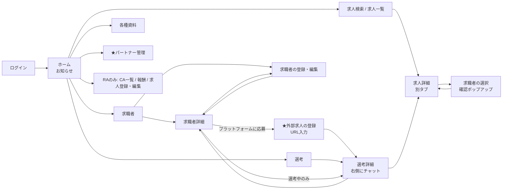
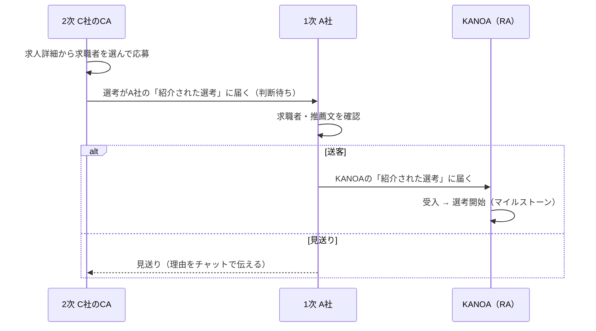

# KANOA Partner Portal V2 設計書（2026-10 再設計版）

作成日: 2026-10-15 ／ 状態: **確定**（2026-10-15 OK。要確認Q1〜Q6は仮案どおり採用）
前版: `設計書.md`（2026-07版・8/13追記）。本書が優先する。前版は経緯の参照用に残す。

根拠にした資料:
- 画面遷移図 `KANOA Portal V2 画面遷移図.canvas`（2026-10-15 ユーザー作成）
- 2026-10-15 ヒアリング（下表）
- `V1からの申し送り.md`（2026-08-13）／議論ログ `2026-07-29_KANOA構造_育てるか作り直すか.md`

---

## 0. 前版からの主な変更

| # | 前版（2026-07） | 本書（2026-10） | 理由 |
|---|---|---|---|
| 1 | 求職者1人＝選考1件 | **求職者と選考を分ける**。選考＝「求職者×求人」。1人を複数の求人に応募できる | 画面遷移図（求職者画面と選考画面が別） |
| 2 | 社内の求人にしか応募できない | **外部求人にURLで応募**できる。登録した時点で「選考」になる | 10/15 要望 |
| 3 | リレー（送客/見送り）の単位が求職者 | リレーの単位が**選考**（求人ごとに送客/見送り） | 1と同じ |
| 4 | アカウント＝会社に1つ | **会社の下に複数のCA**。各自のIDでログイン | 10/15 回答 |
| 5 | 連絡＝会社ごとのスレッド | 連絡＝**選考ごと**。選考詳細の右側にチャット。相手は隣の階層だけ | 画面遷移図＋10/15 回答 |
| 6 | 紹介料はKANOA→1次のみ表示 | **各社が自分のフロント向けの表示額を設定**。支払いはKANOA→1次だけ | 10/15 回答 |
| 7 | 画面は会社目線 | **RA（KANOA社員）とCA（パートナー）**の2種類のメニュー | 画面遷移図 |
| 8 | ― | お知らせ・各種資料・CA一覧・報酬を正式に持つ | 画面遷移図＋申し送りC |

---

## 1. 確定済みの方針

| 論点 | 決定 | 決定日 |
|---|---|---|
| 進め方 | V2をゼロから組み直す。V1は切替まで本番運用 | 07-23 |
| 既存データ | 切替時に移行スクリプトで引き継ぐ（パートナーの再登録不要） | 07-23 |
| 実際の紹介料の支払い | ~~KANOA→1次パートナーだけ~~ → **各社が直上の会社から受け取る分をアプリで記録**（14.1） | 07-23／10-15／**10-16 改定** |
| 一括登録（CSV） | 作らない（重複応募の温床になるため） | 07-23 |
| 進捗確認の共有リンク（tracker_links） | 作らない（リレー履歴で代替） | 07-23 |
| 送客の承認 | **残す**。2次以降の応募は、直上の会社が「送客」して初めて上へ届く | 10-15 |
| アカウント | **会社の下に複数のCA** | 10-15 |
| 連絡の相手 | **直上と直下だけ**。KANOA⇔1次、1次⇔2次。KANOAは2次と直接やり取りしない | 10-15 |
| 紹介料の表示 | 各社が**自分のフロント向けの表示額を自分で入力**。KANOA→1次の額は2次以降には見えない | 10-15 |
| デザイン | V1準拠（Inter／JetBrains Mono／インディゴ #4f46e5） | 07-23 |
| チャットの送信 | 送信ボタン or ⌘(Ctrl)+Enter。Enter単体は改行 | 07-23 |
| 公開 | GitHub → Netlify（V1と同じ） | 07-23 |

---

## 2. 用語

| 用語 | 意味 |
|---|---|
| **RA** | KANOAの社員。求人の登録・選考の進行・報酬の管理をする |
| **CA** | パートナー会社の担当者。求職者を登録し、求人に応募させる |
| 会社（パートナー） | CAが所属する単位。企業コードを持つ。KANOA自身は会社の行を持たない |
| フロント | 自社が招待した、1つ下の階層の会社 |
| アップライン | 自社を招待した、1つ上の階層の会社。1次パートナーのアップラインはKANOA |
| ライン | 階層の呼び名。1次＝Aライン、2次＝Bライン…ZZライン |
| 企業コード | 階層の頭文字＋5桁。例 `A00001`／`B00013` |
| **ログインID** | CA個人のID。`企業コード-連番2桁`。例 `A00001-01`。RAはメールアドレスでログイン |
| **求職者** | 仕事を探している人。登録した会社が持ち主 |
| **選考** | 求職者×求人の応募1件。社内求人への応募と外部求人への応募の2種類 |
| **社内求人** | KANOAがポータルに登録した求人 |
| **外部求人** | ポータルに無い求人。応募先のURLを登録して選考として管理する |
| 送客 | フロントから来た選考を、自社のアップラインへ上げる判断 |
| 見送り | フロントから来た選考を、上げずに止める判断 |
| 受入 | KANOAに届いた選考を正式に選考へ進める判断 |
| マイルストーン | 選考フローの各段階（書類選考・面接・内定など）と、その日付 |

---

## 3. 画面と遷移

画面遷移図をもとに、足りない画面を ★ で追加している（追加理由は各画面の注記）。

### 3.1 メニュー

| メニュー | CA | RA | 備考 |
|---|---|---|---|
| ホーム（お知らせ） | 閲覧 | 作成・編集 | 未読はバッジ |
| 求職者 | 自社の求職者 | KANOAが直接持つ求職者＋届いた選考の求職者 | |
| 求人 | 検索・閲覧 | 登録・編集・公開 | |
| 選考 | 自社で紹介した選考／紹介された選考 | 紹介された選考（＝全受入分） | 下記3.6 |
| 各種資料 | 閲覧 | 登録・編集 | 履歴書の雛形・記入見本など |
| ★パートナー管理 | 自社のCA追加・フロント招待・フロント向け紹介料 | ― | 画面遷移図のログイン注記「パートナーが二次パートナーのIDを発行」を実現するため追加 |
| CA一覧 | ― | 全社・全CAのツリー | |
| 報酬 | 1次パートナーのみ（請求の提出） | 承認・支払 | 支払いはKANOA→1次だけ |
| ログアウト | ○ | ○ | 全画面のメニュー下部に常設 |

### 3.2 ログイン
- ID（CAは `A00001-01` 形式、RAはメールアドレス）＋パスワード
- 招待を受けた人は「初回登録」から、企業コード＋初期パスワード→本パスワードを設定

### 3.3 求職者
- 検索窓：名前・ふりがな・メモ・推薦文のフリーワード
- 一覧：名前／担当CA／年齢（生年月日から算出）／メモ／選考中の件数
- 登録・編集（保存したら求職者詳細へ戻る）

| 項目 | 必須 | 備考 |
|---|---|---|
| 候補者名・ふりがな | 名前のみ必須 | |
| 生年月日・性別 | | 年齢は表示時に計算（保存しない） |
| 最終学歴・就業経験社数・現在の雇用形態・直近の年収 | | 雇用形態・学歴は選択式 |
| 現住所（都道府県） | | 47都道府県から選択 |
| メールアドレス・電話番号 | | 電話番号で重複登録を防ぐ（3.9） |
| 希望勤務地＋出張の可否＋転勤の可否 | | |
| 希望年収・推薦文 | | 推薦文はアップラインにも届く |
| 履歴書・職務経歴書 | | アップロード。内定後は「内定承諾資料1〜3」も同じ枠に追加可 |
| 担当CA | | 既定は登録した本人 |
| メモ | | 自社だけが見る |

- 求職者詳細のボタン：編集／戻る／選考詳細へ（選考中のみ。複数あれば一覧から選ぶ）／**プラットフォームに応募（外部求人URLの登録）**
- 詳細の下部に、その求職者の選考一覧（社内・外部の両方）

### 3.4 求人
- 求人検索（CA）：検索メニュー（職種・勤務地・雇用形態・フリーワード）＋求人概要の一覧
- 求人詳細（別タブ）：社名／業務内容／エントリー時必須項目／**紹介料（自社に提示された額）**／「応募する」
- 応募する→求職者の選択（名前・年齢・性別の一覧）→確認ポップアップ「応募する／キャンセル」→応募したら求人詳細へ自動で戻る
  - エントリー時必須項目のうち、求職者に足りない項目があれば、ポップアップで不足を示して止める
- 求人登録・編集（RA）：求人企業／求人名／業務内容／エントリー時必須項目／選考フロー（段階の並び）／KANOA→1次の紹介料／SPI・コンプライアンスチェックの有無／公開状態

### 3.5 外部求人の登録（★追加・10/15要望）
求職者詳細の「プラットフォームに応募」から開く。
- 入力：応募先URL（必須）／求人企業名／求人名／応募日（既定：今日）／選考フロー（既定のひな形から選んで編集可）／メモ
- 保存した時点で**選考（進行中）**になり、選考詳細へ移る
- リレー（送客の承認）は通らない
- 見える範囲・紹介料の扱いは **要確認 Q1**

### 3.6 選考
上部で2つに分ける（10/15回答の示唆どおり）。

| タブ | 中身 | 見える会社 |
|---|---|---|
| 自社で紹介した選考 | 自社の求職者の選考（社内・外部） | CA |
| 紹介された選考 | フロントから届いた選考。**判断待ち（送客/見送り）を最上段に固定** | CA（フロントがいる会社）、RA |

- 一覧の列：名前／求人企業名／各マイルストーンと日付（横並びの進捗）／紹介元（直下の会社）／状態
- 検索窓：名前・求人企業名

### 3.7 選考詳細
- 左：求職者名（クリックで求職者詳細）／求人企業名（クリックで求人詳細を別タブ）／**紹介料（自分に提示された額）**／マイルストーンと日付／経路（どこを通ってきたか）
- 右：チャット（縦長・チャット形式）
  - 自分が中間の会社（例：1次で、2次から届いた選考）のときは、**「アップラインとの連絡」と「紹介元との連絡」の2つをタブで切り替える**
  - 相手は直上と直下だけ（KANOAは1次とだけ、1次はKANOAと2次と）
- ボタン：戻る／**選考を辞退**（紹介した側のみ）／送客・見送り（判断待ちのときだけ）／受入（RAのみ）／マイルストーンの更新（**要確認 Q5**）

### 3.8 ホーム・各種資料・CA一覧・報酬
- ホーム：お知らせ（RAが作成・公開範囲（全社／選んだ会社）・ピン留め・下書き）＋自分の「今日やること」（判断待ちの選考数・未読チャット数）
- 各種資料：分類別の一覧。RAが登録・並べ替え・公開切替。CAは閲覧とダウンロード
- CA一覧（RA）：会社のツリー（A→B→C…）と各社のCA、稼働状況
- 報酬：1次パートナーの請求（下書き→提出→承認/差戻し→支払）。選考ごとの支払ステータス（支払待ち／支払済み／返金済み）。早期退職・返金を含む

### 3.9 重複の防ぎ方
- 同じ電話番号の求職者は登録できない（全社横断。V1と同じ）
- 同じ求職者を同じ社内求人に2回応募できない
- 外部求人は同じURLへの二重登録を警告（止めない）

---

## 4. 業務の流れ

### 4.1 社内求人への応募（リレーあり）

- 1次パートナーが応募した場合は、直接KANOAに届く
- RAがKANOA自身の求職者を応募させた場合は、最初から選考開始
- 送客/見送り/受入/辞退はすべて履歴に残る（誰が・いつ・コメント）

### 4.2 外部求人への応募
求職者詳細→プラットフォームに応募→URL等を入力→即「選考（進行中）」。マイルストーンは登録した側が更新する。

### 4.3 連絡（隣の階層だけ）
1つの選考に、隣り合う会社のペアごとにスレッドがある。

| 選考の出どころ | スレッド |
|---|---|
| 1次 A社の求職者 | A⇔KANOA |
| 2次 C社の求職者（A社経由） | C⇔A、A⇔KANOA（KANOAはC⇔Aを見ない／CはA⇔KANOAを見ない） |

チャット機能はV2で作ったものを引き継ぐ：返信・編集・削除・既読・未読に戻す・リアクション（吹き出しの外）・ピン留め・スタンプ・送信は⌘(Ctrl)+Enter。

### 4.4 紹介料の見え方

| 見る人 | 表示される額 | 入力する人 |
|---|---|---|
| 1次 A社 | KANOA→A社の紹介料 | RA（求人ごと。会社ごとの上書きは **要確認 Q3**） |
| 2次 C社 | A社がフロント向けに設定した額 | A社 |
| 3次 | 2次が設定した額 | 2次 |

- 各社は自分の上から提示された額しか見えない（DBの権限で守る。画面で隠すだけにしない）
- ~~実際の支払い・請求はKANOA⇔1次だけ。2次以降の額は「表示用」でアプリは支払いを管理しない~~ → 10-16 改定：2次以降への支払いもアプリで記録する（14.1）
- フロント向けの額の設定単位は **要確認 Q2**

### 4.5 招待とアカウント
- フロントの招待：パートナー管理→招待コード発行→「ログインURL＋企業コード＋初期パスワード」の定型文をコピーして送る（初期パスワードは発行画面に一度だけ表示・14日で失効）
- 自社のCA追加：パートナー管理→CAを追加→ログインID（`A00001-02`）と初期パスワードを一度だけ表示。初回ログインでパスワード変更を強制
- 誰が招待・追加できるかは **要確認 Q4**

---

## 5. データモデル

> **命名規則（2026-10-15追加）**：V1と同じSupabaseを共有しているため、V2のテーブル・DB関数・Edge Function・Storageバケットにはすべて `v2` 接頭辞を付ける（例：`v2_members`、`v2-invite-issue`、バケット `v2-files`）。V1には `members` `notices` `invoices` `messages` など同名候補が既にあるため。下表は接頭辞を省略して書く。

V1のテーブルには触れない（切替まで並行）。前版V2のテーブルは**お試し移行のデータしか入っていないため、作り直す**（実装時に削除の承認を取る）。

全テーブル共通：`id uuid`（DB既定値）／`created_at`／`updated_at`／**`version int`（楽観ロック。読んだ時と違えば更新を拒否）**。

| テーブル | 主な列 | 役割 |
|---|---|---|
| companies | code, tier, parent_id, name, status | パートナー会社（木構造） |
| members | user_id(auth), company_id(nullならRA), role(ra/ca), login_id, name, email, is_owner, status, must_change_pw | 個人アカウント |
| invites | issued_by, code, tier, company_name, temp_pw_hash, status, expires_at | フロント招待 |
| clients | name, 業種, 備考 | 求人企業 |
| jobs | client_id, title, description, entry_requirements(jsonb), flow(jsonb:段階の並び), checks(SPI等), status, 勤務地・給与・雇用形態, detail(jsonb) | 社内求人。**紹介料の列は持たない** |
| job_fees_kanoa | job_id, fee, company_id(null=基本額) | KANOA→1次の紹介料。RAと該当1次だけが読める |
| job_offers | job_id, offered_by(company), fee_display, published | 各社がフロントへ出す求人と表示額 |
| candidates | owner_company_id(nullならKANOA), assigned_member_id, 3.3の全項目, memo | 求職者 |
| candidate_files | candidate_id, kind(resume/cv/offer_1..3/other), storage_path, size, mime | 書類 |
| applications | candidate_id, kind(internal/external), job_id, external_url, external_company, external_title, applied_by_company, applied_by_member, holder_company_id, stage(relay/active/stopped/withdrawn/closed), status, joined_on, pay_status, admin_note | **選考** |
| application_parties | application_id, company_id | その選考を見てよい会社（送客のたびに追加）。権限判定を速く・単純にするための表 |
| application_events | application_id, company_id, member_id, action(applied/forwarded/rejected/accepted/withdrawn/status_changed), note | 経路と操作の履歴 |
| milestones | application_id, seq, name, scheduled_on, done_on, result | 選考フローの各段階と日付 |
| messages | application_id, thread_company_id(下側の会社), sender_member_id, side(self/up), body, reply_to, reactions, stamp, pinned, edited, deleted | 選考チャット |
| thread_reads | application_id, thread_company_id, member_id, last_read_at | 既読・未読に戻す |
| notices / notice_reads | title, body, audience, target_company_ids, pinned, status | お知らせ |
| resources | title, category, storage_path or url, sort, published | 各種資料 |
| invoices | company_id(1次のみ), no(sequence), status, items, 金額, 日付, history | 請求・報酬 |
| audit_log | table, row_id, actor, action, before, after | 操作記録（申し送りD-2） |

---

## 6. 権限

### 6.1 見える範囲（DBの権限で強制する）

| データ | CA（自社＝X社） | RA |
|---|---|---|
| 求職者 | Xが持ち主のもの＋Xに届いた選考の求職者 | KANOA所有＋KANOAに届いた選考の求職者 |
| 選考 | Xが紹介したもの＋Xに届いたもの（application_partiesにXがある） | KANOAに届いたもの＋KANOA自身の選考 |
| チャット | thread_company_id＝X（Xとアップの会話）＋thread_company_idがXのフロント（Xとフロントの会話） | thread_company_idが1次の会社 |
| 紹介料 | Xへの提示額＋Xがフロントに出した額 | 全部 |
| 会社 | 自社＋自社のフロント | 全社 |

RAは管理のため全社のツリーと選考の経路を見られる。ただし**やり取りは1次とだけ**（チャットの書き込み権限で制限）。

### 6.2 操作

| 操作 | できる人 |
|---|---|
| 求職者の登録・編集 | 持ち主の会社のCA |
| 応募（社内求人） | 持ち主の会社のCA。求人がXに提示されていること |
| 外部求人の登録 | 持ち主の会社のCA（RAはKANOA所有の求職者に対して） |
| 送客・見送り | 判断待ちの選考を持つ会社のCA |
| 受入 | RA |
| 辞退 | 紹介した側（持ち主の会社） |
| マイルストーンの更新 | 社内求人：要確認 Q5／外部求人：登録した会社 |
| 管理者メモ・支払ステータス | RAのみ（パートナーからは列ごと送れない） |

送客・受入・辞退・応募はDBの関数（RPC）でだけ行う。画面から状態の列を直接書き換えさせない。
権限が無い操作は**黙って無視せずエラーを返す**（申し送りB-1の反省）。

---

## 7. 認証

- RAもCAも**Supabase Authの正規ユーザー**（1人1ユーザー）
- CAのログインIDは内部的に仮想メールに変換（`a00001-01@id.kanoa-portal.invalid`）。画面ではIDしか見せない
- ログインは標準の `signInWithPassword` で行う。セッション更新も標準のまま（V1の「リロード後に実質アプリ側だけの認証」を解消）
- 権限の判定はJWTの `app_metadata`（role / company_id / member_id）とmembersテーブル
- Edge Function（サーバー側の処理）は次の3つだけ
  - `invite-issue`（企業コード採番・初期パスワード生成）
  - `invite-accept`（会社＋代表CAのアカウント作成）
  - `member-create`（自社のCA追加）
  - 移行期間だけ `legacy-login`：V1のパスワードで入れなかった場合に旧方式で照合し、一致したら新方式へ自動で置き換える（パートナーの作業ゼロ）

---

## 8. V1の申し送りをどこで断つか

| 申し送り | 本書での対処 |
|---|---|
| A-1 全件メモリ＋一括上書き | 行単位で書く・`version` で楽観ロック・全件を持たない |
| A-2 権限のない列まで送る | 操作ごとに変える列だけ送る＋列単位の権限をDBで持つ |
| A-3 会社名の文字列一致 | すべてIDで結ぶ（application_parties） |
| A-4 DOMの使い回し | 画面・モーダルは閉じたら破棄。例外は握り潰さず失敗帯に出す |
| A-5 件数増で破綻 | 一覧はページング、集計はDBのcount/RPC |
| B-1 列の書き込み制限 | トリガーで制限し、**エラーを返す** |
| B-2/F 匿名アップロード・公開フォーム | 公開フォームは作らない（2次も自分でログインする）。アップロードはログイン必須 |
| B-3 採番 | UUIDはDB既定値、請求番号はsequence、一意制約 |
| D-1 消える失敗表示 | 失敗は閉じるまで残る帯＋コピーボタン |
| D-2 操作記録 | audit_log をトリガーで自動記録 |
| D-3 古い画面の放置 | 新しい版を検知して、安全なときは自動再読込・入力中は帯で促す |
| D-4 サーバー定義がリポジトリに無い | SQL・RLS・Edge Functionはすべてリポジトリ管理。権限テストを用意 |
| E 移行データの癖 | 移行スクリプトで正規化。**件数に加えて金額の合計も照合** |
| G 進め方 | 直す前に再現テスト。同型のバグは横展開。SQLは実測してから |

---

## 9. V1機能の取り込み

| V1の機能 | V2 | 理由 |
|---|---|---|
| 求職者登録・選考管理・書類 | 取り込む（形を変える） | 中核 |
| 案件登録・公開 | 求人として取り込む | |
| 二次パートナー | マルチレベル（招待）で置き換え | |
| 紹介料・請求・返金・早期退職・支払ステータス | 報酬として取り込む | |
| 連絡（会社単位） | 選考単位のチャットに置き換え | 画面遷移図 |
| お知らせ・ホーム | 取り込む | |
| 管理者メモ | 取り込む（選考に付ける） | |
| 内定承諾資料1〜3（表示名と保存値を分ける） | 取り込む | |
| 雛形・記入見本 | 各種資料に置く | |
| SPI・コンプライアンスの案件別ON/OFF | 取り込む（求人の設定） | |
| 一括送信（一斉連絡） | **要確認 Q6** | 選考単位のチャットとは形が合わない |
| CSV一括登録 | 作らない | 07-23 決定 |
| 進捗確認リンク（tracker_links） | 作らない | 07-23 決定 |
| 紹介フォーム（未ログインの登録） | 作らない | 2次も自分でログインして登録する。匿名登録の穴（KPP-002/003）も同時に消える |

---

## 10. 前版V2のコードの扱い

| 部品 | 扱い |
|---|---|
| 画面の骨格（index.html・router・ui部品・CSS・fonts） | 再利用 |
| 書類の部品（docs.js） | 再利用（保存先を candidate_files に） |
| チャット（chat.js） | 描画と機能は再利用。キーを「会社」から「選考＋会社」へ |
| ログイン（会社ごとの認証） | 作り直す（個人ごとの認証へ） |
| 招待のEdge Function | 手直しして再利用 |
| リレーのRPC | 手直しして再利用（求職者単位→選考単位） |
| DBのテーブル・RLS | 作り直す |
| 移行スクリプト | 作り直す（金額の合計照合を追加） |

---

## 11. フェーズ計画

| # | 内容 | 完了条件 |
|---|---|---|
| 0 | 本書のレビュー＋要確認の回答 | あなたのOK |
| 1 | 土台：テーブル・権限・個人ログイン・RA/CAのメニュー・ホーム（お知らせ） | RAとCAでログインし、それぞれのメニューとお知らせが出る |
| 2 | 求職者と求人：登録・検索・詳細（別タブ）・書類・フロント向け紹介料 | CAが求職者を登録し、提示された求人と紹介料が見える |
| 3 | 選考：応募・リレー（送客/見送り/受入）・外部URL・マイルストーン・辞退・選考一覧の2タブ | C社→A社→KANOAで1件通り、外部URLの選考も1件できる |
| 4 | 選考チャット（隣の階層だけ・2タブ） | C⇔A、A⇔KANOAの会話が混ざらない |
| 5 | 各種資料・CA一覧・パートナー管理（招待・CA追加）・報酬 | V1でできることがV2でできる |
| 6 | 移行・公開・切替 | 件数と金額の照合が一致し、本番を切り替える |

---

## 12. 要確認 → 2026-10-15 すべて仮案どおり採用

下記の括弧内の案で確定（ユーザー回答「全部仮でOK」）。

- **Q1 外部求人の選考は誰に見え、紹介料の対象になりますか？**（仮：登録した会社の中だけに見える。アップライン・KANOAには見えない。紹介料・報酬の対象外）
- **Q2 フロント向けの表示額は、どの単位で設定しますか？**（仮：求人ごとに1つの額を決めて、フロント全社に同じ額で出す）
- **Q3 KANOA→1次の紹介料は、会社ごとに変えますか？**（仮：求人ごとの基本額＋会社ごとの上書き。V1と同じ）
- **Q4 CAの追加とフロントの招待は、会社の誰ができますか？**（仮：最初に登録した代表CAだけ）
- **Q5 社内求人のマイルストーンを更新するのは誰ですか？**（仮：RAだけ。CAは閲覧と辞退だけ）
- **Q6 一斉連絡は残しますか？**（仮：チャットではなく「お知らせ」で代替する）

---

## 13. 後日修正（実装後に出た指摘）

| 日付 | 項目 | 内容 | 暫定の扱い |
|---|---|---|---|
| 2026-10-15 | エントリー時必須項目 | 求人登録画面で確認した結果、ユーザーの想定と違う（詳細は後日すり合わせ） | 応募は止めず、確認ポップアップに「不足している項目」を表示するだけにする |
| 2026-10-15 | チャットの既読 | 「相手の会社の誰か1人でも読めば既読」になっている（独立レビューの指摘12） | 運用で困るか様子を見る |
| 2026-10-15 | チャットの送信者名 | 相手の会社の担当者名がチャットに出る（独立レビューの指摘13） | **対応済み**：ユーザー指定で非表示。相手の会社の人の名前はサーバーから返さない（112）。自社側の同僚の名前は表示 |

---

## 14. 報酬（2026-10-16 決定）

| 論点 | 決定 |
|---|---|
| 紹介料の発生時点 | **入社時の成約報酬だけ**（V1の「送客報酬」＝入社しなくても送客時点で発生する報酬は持たない） |
| 入社の判定 | 社内求人の選考フローの**最後の段階が「通過」**になった時点。入社日＝その段階の実施日 |
| 金額の記録 | 入社確定時の紹介料（税抜）と返金規定を、その選考の記録として**固定**する（後で求人の設定を変えても過去分は変わらない） |
| 支払先 | 経路上の**1次パートナー**（KANOA自身の求職者・外部求人は対象外） |
| 請求書 | **作らない**（後日追加の可能性あり）。報酬の画面で、税抜・消費税・税込を表示する |
| 消費税 | 求人の紹介料は**税抜**。消費税10%（1円未満切り捨て）を足して税込を表示（V1と同じ） |
| 返金規定 | **求人ごと**に「◯か月以内 ◯%」を何行でも登録。退職日を記録すると、入社日からの経過で返金率と返金額を自動計算 |
| 見える人 | RA：全件（支払済み・退職・返金済みを記録）／各社：自社が受け取る分を閲覧のみ（2次以降も。14.1で改定） |
| 返金規定の見える範囲 | 求人の返金規定の設定はRAと、その求人を提示された1次パートナーだけ。**報酬の行に固定された返金規定は、その行を受け取る会社（2次以降も）に見える**（自分の返金率を知るため。10-16 決定） |

旧「3.8 報酬：1次パートナーの請求（下書き→提出→承認/差戻し→支払）」と「5. invoices」は本決定で置き換える。

### 14.1 多階層の報酬（2026-10-16 決定）

7月の「アプリが扱う支払いはKANOA→1次だけ」を改め、**各社が直上の会社から受け取る報酬**をアプリで扱う。

| 論点 | 決定 |
|---|---|
| 2次以降の報酬画面 | 1次と同じ画面。各社は**直上の会社から受け取る分**を見る（1次＝KANOAから、2次＝1次から） |
| 2次以降が受け取る額 | 直上の会社がフロント向けに設定した表示額（入社確定時点で固定） |
| 2次への支払いの記録 | **直上の会社（1次）がつける**（KANOAが1次の分をつけるのと同じ形） |
| 2次の分の返金規定 | **KANOAが求人ごとに決める**（解釈：KANOAが求人に登録している返金規定を、2次以降にもそのまま当てはめる。別建てが必要なら追加） |
| 報酬画面に出すもの | **受け取る分だけ**（1次の報酬画面に「フロントへ支払う分」は出さない） |
| 支払前の早期退職 | **支払額から差し引く**（2026-10-16 決定。支払後の退職は返金） |
| フロントへの支払いの記録場所 | **パートナー管理**に「フロントへの支払い」の欄を設ける（2026-10-16 決定）。支払済み・退職・返金済みの記録は、KANOAが1次の分をつけるのと同じ操作 |

**実装（2026-10-16・`120_multilevel_rewards.sql`）**
- 報酬の表は1つの選考に**段ごとの行**（`payer_company_id`＝支払う会社。空＝KANOA）。入社確定時に KANOA→1次の行と一緒に、経路上の2次以降の行を作る
- 2次以降の額＝直上の会社の `v2_job_offers.fee_display`（公開を止めていても設定額を使う）。~~設定が無い段は行を作らない~~（122で変更）。返金規定はKANOA→1次の行と同じもの
- 見える範囲：RAは全件／受け取る会社・支払う会社のメンバーはその行だけ（2次からKANOA→1次の行は見えない。他の組の行も見えない）
- 記録できる人：KANOAが払う行＝RA（報酬の画面）／会社が払う行＝**その会社の代表者だけ**（パートナー管理「フロントへの支払い」）。操作の中身は118・119と同じ
- 報酬の画面はCA全社に表示（受け取る分だけ・閲覧のみ）。説明文に支払元（KANOA／直上の会社のコードと社名）を出す
- どの段かに支払・退職の記録があれば、RAは入社日の変更・入社の取り消しができない（理由に支払った会社のコードを出す）
- ~~退職は各段の支払う側がそれぞれ記録する（自動で下の段に反映しない）~~（122で変更）
- 119レビューのLow：0円は支払済みにできない（画面にボタンを出さない・DBもP0400）／返金の扱いは支払済みのときだけ（制約）／返金0円で支払済みを取り消した後、本来の支払日で元の形に戻せる／取り消し後の知らせは返った状態に合わせる
- 121（レビュー修正）：4つの操作に楽観ロック（画面が読んだ version を送る。古ければ止めて画面を読み込み直す）／権限が無い・行が無いは同じ返事／操作中に行が消えたら止める／マイルストーンの更新は未ログインで呼べない
- 123（122のレビュー修正）：退職の記録（下の段への反映あり）も選考の行を先にロックする（マイルストーンの更新と同じ「選考→報酬」の順で行き詰まらない）／退職の記録が無い行の「消す」で下の段を動かさない／画面で「紹介料を入れる」の前に税抜・消費税・税込の額と「後から変えられない」ことを確認する

**運用ルール（2026-10-16 決定「全部推奨どおり」・`122_reward_decisions.sql`）**

| 論点 | 決定 |
|---|---|
| 退職の記録 | **下の段に自動で反映**（二度手間防止）。ある段で退職を記録・変更すると、その下の段すべてに同じ退職日を入れる（支払前＝差し引き／支払後＝返金）。消すときは同じ日付が入っている下の段だけ消す。返金済み・差し引き後の額で支払済みの行は動かさない。上の段には反映しない |
| フロント向けの額が未設定のまま入社 | **0円（紹介料 未設定）の行を作る**（下の段にも入社が見えるように）。支払う側がパートナー管理の「紹介料を入れる」で額（税抜）を入れる。入れられるのは0円の行に1回だけ。支払前の退職があれば固定済みの返金率で差し引きを計算し直す |
| 支払う会社が記録できない（利用停止中・利用中の代表者なし） | **KANOA（RA）が代わりに記録**できる（紹介料を入れる・支払済み・退職・返金済み）。RAの報酬の画面に「KANOAが代わりに記録するフロントへの支払い」として出す |
| 2次以降に見える返金規定 | 自分の行に固定された返金規定は**見えてよい**（14の表を改定） |

---

## 15. チャットのファイル添付（2026-10-19 追加・ユーザー要望）

| 論点 | 決定 |
|---|---|
| 送れるもの | PDF・画像（JPEG／PNG／GIF／WebP）。1回に5つまで・1つ10MBまで。本文と一緒でも、ファイルだけでも送れる（スタンプとは一緒に送れない） |
| 見られる人 | その会話の2社だけ（直上⇔直下。置き場 `v2-files/chat/{選考ID}/{会話の会社ID}/` の権限で強制） |
| 表示 | 画像は会話の中に小さく表示し、押すと拡大。PDFはファイル名のカードで、押すと別タブで開く |
| 削除 | メッセージを削除すると、添付も見えなくなり、送った本人の画面がファイルの実体も置き場から消す（実体が消えれば、発行済みの開くためのURLも、削除後おおむね1〜2分以内に開けなくなる） |

**実装（`124_chat_files.sql`・`125_chat_files_removal.sql`）**
- 画面がファイルを置く → `v2_msg_send(p_files)` に置いた場所を渡す。関数は画面の申告ではなく置き場の記録で「本人が置いた・この会話の場所・10MB以下・PDF/画像・未使用」を確かめてから紐づける
- 送信に失敗して紐づかなかったファイルと、削除したメッセージのファイルは、置いた本人だけが消せる
- 置き場の配信（CDN）は、同じ人が直前に開いたファイルや発行済みのURLをしばらく覚えている（実測で数秒〜30秒超、テストでは最大120秒まで待つ）。権限だけでは即座に隠せないため、削除時は実体を消す。削除後、おおむね1〜2分以内に開けなくなる。開くためのURLは10分で切れる

**手直し（`126_chat_files_hardening.sql`・2026-10-19 独立レビューの指摘）**
- 送信後の中身のすり替え防止: 送信時に置き場の記録の id も覚え、開けるのは「同じ id の実体がまだその場所にある」ときだけ。送信済みの場所には、誰も置き直せない・上書きできない（削除済みメッセージの場所も同じ）。送信の関数は置き場の記録の行を押さえてから確かめ・紐づける
- 置ける場所の形を厳しくした: `chat/{選考ID}/{会話の会社ID}/{ランダムなUUID}.{pdf|jpg|png|gif|webp}`（UUIDは小文字の正規の形だけ。階層の追加は不可）
- ファイル名から、文字の向きを変える制御文字（U+202A〜U+202E・U+2066〜U+2069）を取り除いて記録する
- 消し残しの消し直し: 置き場からの削除は、送った本人の画面が行う（定期的に掃除する仕組みは置かない）。削除の時に消せなかった分（通信の失敗・画面を閉じた等）と、送信に紐づかないまま1時間を過ぎた分は、本人が次にその選考の連絡を開いたときに画面が黙って消し直す（`v2_my_chat_files_pending_removal` が本人の分だけ返す）
- **残る制約（受け入れ済み）**
  - 会話の相手がすでに作った「開くためのURL」は、実体を消すまで取り消せない（期限は10分。実体を消せば、上のとおり1〜2分以内に開けなくなる）。送った本人がメッセージを削除した後、本人が再訪するまで実体が残った場合は、その間URLの期限内なら開けることがある
  - 送らずに置いたままのファイル（送信の失敗・途中で画面を閉じた等）は、置いた本人の次の来訪で消える。来訪が無ければ残る（本人以外には見えない）

- 置き場 `v2-files` のバージョン管理（versioning）は**無効のまま**にする。有効にすると、削除が「保管」になり同じIDが残るため、添付の開ける・開けないの判定が崩れる（独立点検の指摘・2026-10-19）

---

## 16. 移行・切替の方針（2026-10-19 決定「推奨どおり」）

| 論点 | 決定 |
|---|---|
| パートナーのログイン | V1のID（PT03 など）とパスワードのまま、V2に入れるようにする（切替当日に結びつける）。社内の企業コードはV2の形式を新しく振る |
| 2次パートナー | V1は社名の文字だけ → 求職者の「紹介元」として残し、1次の会社の求職者として移す（2次の会社は作らない。必要になったらV2で招待） |
| 会社単位の連絡（求職者に紐づかない約20件） | V2には入れず、ファイルに書き出してKANOAで保管 |
| 未承認の紹介フォーム（約14件） | その会社の求職者として登録（選考なし）。却下済みは移さない |
| KA999・RE999 | テスト用のため移さない |
| 切替のURL | V1と同じURLのままV2に差し替える（パートナーのブックマークを変えさせない） |
| エントリー時必須項目 | 切替前にすり合わせる |
| 入社日があるのに「内定」の人（V1） | 今の扱いのまま（入社日になったら KANOA が記録する）（10-29） |
| PT000「株式会社テスト」 | 移さない（KA999・RE999 と同じ）。その会社の求職者・書類・連絡は「意図して移さない」と数える（10-29・137） |
| 求人企業から KANOA への紹介料（V1 の client_fee） | KANOA だけが見られる表 v2_job_client_fees に置く。求人の編集・詳細（RA）・CSV一括登録で扱う（10-29・137/138） |
| V1 の文字のリアクション | ✅ に置き換える（10-29・137） |
| 公開前の確認 | V1を動かしたまま、V1のデータの写しをV2に流して出来栄えを確認する（V1には書き込まない・何度でも取り直せる・切替当日も同じ手順） |

